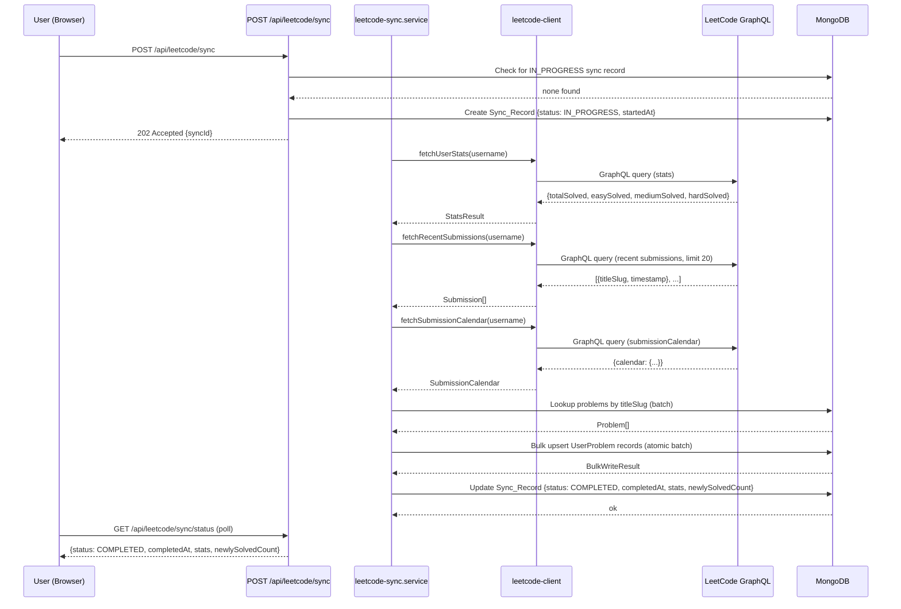

# Design Document: LeetCode Sync

## Overview

LeetCode Sync (Approach A — Stats Sync) adds a one-way data bridge between a user's public LeetCode profile and DSA Tracker. The feature is intentionally read-only and credential-free: it queries LeetCode's public GraphQL endpoint to fetch aggregate solved counts and recent accepted submissions, cross-references those submissions against the app's problems database, and auto-marks matching problems as SOLVED in the user's progress. Users see their LeetCode stats on the dashboard in a dedicated "LeetCode Stats" section alongside their existing in-app stats.

The design adds two new modules (`leetcode-client` and `leetcode-sync.service`), one new MongoDB collection (`leetcodeSyncs`), extends two existing collections (`users`, `userProblems`), and adds five new API routes. It integrates with the existing Next.js 15 App Router, Mongoose, Auth.js session pattern, and Vercel cron infrastructure.

### Key Design Decisions

- **No LeetCode credentials stored** — only a public username is stored; all queries use LeetCode's unauthenticated public GraphQL endpoint.
- **Sync is async from the user's perspective** — POST /api/leetcode/sync returns HTTP 202 immediately and the sync runs server-side; the client polls GET /api/leetcode/sync/status for updates.
- **Atomic batch upserts** — all UserProblem status changes for a single sync are applied together; any DB failure rolls back the entire batch and marks the sync FAILED.
- **Cap at 10 sync records per user** — the oldest record is evicted before inserting a new one to keep storage bounded.
- **Source tracking** — the `source` field on UserProblem distinguishes LEETCODE_SYNC from MANUAL entries, enabling future analytics.
- **60-minute cron cooldown** — the cron job skips users synced in the last 60 minutes to respect LeetCode's public API and avoid hammering the endpoint.


---

## Architecture

The feature follows the same layered architecture as the rest of the app:

```
Browser (React Client Components)
  │
  ├── Dashboard UI (LeetCode Stats section + Sync button)
  └── Profile Settings UI (Username input + Auto-sync toggle)
           │
           ▼
Next.js App Router (Route Handlers)
  ├── POST /api/leetcode/sync            ← manual trigger
  ├── GET  /api/leetcode/sync/status     ← poll for sync state
  ├── POST /api/leetcode/validate-username
  ├── GET  /api/user/settings            ← includes LeetCode fields
  ├── PATCH /api/user/settings           ← save username / toggle
  └── GET  /api/cron/leetcode-sync       ← Vercel cron job
           │
           ▼
Service Layer (lib/services/)
  └── leetcode-sync.service.ts
        ├── runSync(userId)              ← orchestrates full sync
        ├── getSyncStatus(userId)        ← returns last sync record
        └── getCronEligibleUsers()       ← filters users for cron
           │
           ▼
LeetCode Client (lib/leetcode/)
  └── leetcode-client.ts
        ├── fetchUserStats(username)
        ├── fetchRecentSubmissions(username)
        ├── fetchSubmissionCalendar(username)
        └── validateUsername(username)
           │
           ▼ (HTTP, public GraphQL)
LeetCode API  https://leetcode.com/graphql
           │
           ▼
MongoDB Atlas
  ├── users           (+ leetcodeUsername, leetcodeSyncEnabled)
  ├── userProblems    (+ source field)
  └── leetcodeSyncs   (new collection)
```


### Sync Flow Sequence




---

## Components and Interfaces

### 1. LeetCode Client (`lib/leetcode/leetcode-client.ts`)

The client encapsulates all HTTP communication with LeetCode's public GraphQL endpoint. It applies a 10-second `AbortController` timeout to every request.

```typescript
// Types
export interface LeetCodeStats {
  totalSolved: number;
  easySolved: number;
  mediumSolved: number;
  hardSolved: number;
}

export interface LeetCodeSubmission {
  titleSlug: string;
  timestamp: number; // Unix timestamp
}

export type SubmissionCalendar = Record<string, number>; // unix_ts_string → count

// Client interface
export interface ILeetCodeClient {
  validateUsername(username: string): Promise<boolean>;
  fetchUserStats(username: string): Promise<LeetCodeStats>;
  fetchRecentSubmissions(username: string, limit?: number): Promise<LeetCodeSubmission[]>;
  fetchSubmissionCalendar(username: string): Promise<SubmissionCalendar>;
}
```

GraphQL queries sent to `https://leetcode.com/graphql`:

- **Stats query**: `userPublicProfile` → `submitStats.acSubmissionNum` (per difficulty)
- **Submissions query**: `recentAcSubmissionList(username, limit: 20)` → `{titleSlug, timestamp}`
- **Calendar query**: `userProfileCalendar` → `submissionCalendar` (JSON-encoded map)
- **Validation query**: `matchedUser(username)` → `{username}` (null if not found)


### 2. Sync Service (`lib/services/leetcode-sync.service.ts`)

Orchestrates the full sync workflow.

```typescript
export type SyncStatus = "IN_PROGRESS" | "COMPLETED" | "FAILED";
export type SyncStage = "FETCH_STATS" | "FETCH_SUBMISSIONS" | "CROSS_REFERENCE" | "PERSIST";
export type SyncFailureReason = "TIMEOUT" | "HTTP_ERROR" | "INVALID_RESPONSE" | "DB_ERROR" | "NETWORK_ERROR";

export interface SyncResult {
  syncId: string;
  status: SyncStatus;
  startedAt: Date;
  completedAt?: Date;
  stats?: LeetCodeStats;
  newlySolvedCount?: number;
  error?: { stage: SyncStage; reason: SyncFailureReason; detail?: string };
}

// Service interface
export async function runSync(userId: string): Promise<SyncResult>;
export async function getSyncStatus(userId: string): Promise<SyncResult | null>;
export async function getCronEligibleUsers(): Promise<string[]>;
```

**`runSync` algorithm:**

1. Check for existing `IN_PROGRESS` record → return 409 if found
2. Evict oldest record if count ≥ 10
3. Insert `Sync_Record` with `status: IN_PROGRESS`, `startedAt: now`
4. Call `fetchUserStats` → on failure, update record to FAILED and return
5. Call `fetchRecentSubmissions` → on failure, update record to FAILED and return
6. Call `fetchSubmissionCalendar` → on failure, update record to FAILED and return
7. Batch-lookup problems by `slug` from the submissions list
8. Compute upserts: for each matching problem, build a `bulkWrite` operation
   - If no existing UserProblem → insert `{status: SOLVED, source: LEETCODE_SYNC, solvedAt: submission.timestamp}`
   - If existing with non-SOLVED status → update to `{status: SOLVED, source: LEETCODE_SYNC, solvedAt: submission.timestamp}`
   - If existing with SOLVED status → skip (do not overwrite `solvedAt`)
9. Execute `bulkWrite` atomically → on any error, abort and update record to FAILED (`PERSIST` stage)
10. Count transitions (non-SOLVED → SOLVED)
11. Update `Sync_Record` to `status: COMPLETED`, `completedAt: now`, `stats`, `newlySolvedCount`


### 3. API Routes

#### `POST /api/leetcode/sync`

- **Auth**: Requires valid session (`auth()`). Returns 401 if unauthenticated.
- **Body**: `{}` (userId taken from session)
- **Response**: 202 `{syncId}` on acceptance, 409 if sync already in progress, 400 if no `leetcodeUsername` saved
- **Side effect**: Calls `runSync(userId)` — this runs synchronously within the request for MVP; a future iteration can move to a background queue.

#### `GET /api/leetcode/sync/status`

- **Auth**: Requires valid session. Returns 401 if unauthenticated.
- **Response**: Most recent `Sync_Record` for the user as `SyncResult | null`

#### `POST /api/leetcode/validate-username`

- **Auth**: Requires valid session. Returns 401 if unauthenticated.
- **Body**: `{ username: string }`
- **Validation**: Zod schema — trims whitespace, enforces `/^[a-zA-Z0-9_-]{1,39}$/`
- **Response**: 200 `{valid: true}` | 422 `{error: "profile_not_found"}` | 503 `{error: "service_unavailable"}`

#### `GET /api/user/settings`

Extended to include `leetcodeUsername` and `leetcodeSyncEnabled` in the returned settings object. Reads from the `users` collection.

#### `PATCH /api/user/settings`

Extended to accept `leetcodeUsername` (string | null) and `leetcodeSyncEnabled` (boolean) in the request body. Persists to the `users` collection. Submitting null/blank `leetcodeUsername` clears the field and sets `leetcodeSyncEnabled: false`.

#### `GET /api/cron/leetcode-sync`

- **Auth**: Validates `x-cron-secret` header against `process.env.CRON_SECRET`
- **Logic**: Calls `getCronEligibleUsers()`, then `runSync()` for each (using `Promise.allSettled` to isolate failures)
- **Response**: `{ processed: number, skipped: number, failed: number }`


### 4. Frontend Components

#### `LeetCodeSyncSection` (Dashboard client component)

- Fetches `GET /api/leetcode/sync/status` on mount
- Conditionally renders:
  - **No `leetcodeUsername` on user**: prompt with link to `/profile`
  - **Has username, no completed sync**: "Never synced" + sync button
  - **Has username, has completed sync**: "LeetCode Stats" card grid + "Last synced X ago" label + sync button
  - **Sync in progress**: loading spinner on sync button, button disabled
  - **Last sync failed**: "Last sync failed {relative time}" label + toast on transition
- Polls `GET /api/leetcode/sync/status` every 3 seconds while a sync is `IN_PROGRESS`
- On successful completion, updates stats and status label within 2 seconds (next poll cycle)
- Uses Zustand store for optimistic UI state during sync button click

#### `LeetCodeSettingsSection` (Profile client component)

- Input field: "LeetCode Username" (text input with trim validation)
- On blur/submit: calls `POST /api/leetcode/validate-username` before saving
- Toggle: "Enable automatic sync" (`leetcodeSyncEnabled`)
- On save: calls `PATCH /api/user/settings`; shows toast on success/failure


---

## Data Models

### Extended `users` collection

Two new fields added to the existing `IUser` interface and `UserSchema`:

```typescript
// Addition to IUser interface (types/index.ts)
leetcodeUsername?: string;        // Optional — null means not configured
leetcodeSyncEnabled: boolean;     // Default: false

// Mongoose schema additions
leetcodeUsername: {
  type: String,
  trim: true,
  sparse: true,   // allows multiple null values with a unique-sparse index
  match: /^[a-zA-Z0-9_-]{1,39}$/,
},
leetcodeSyncEnabled: {
  type: Boolean,
  default: false,
},
```

Index: `leetcodeUsername` sparse (for cron lookups).

---

### Extended `userProblems` collection

One new field added to `IUserProblem` and `UserProblemSchema`:

```typescript
// Addition to IUserProblem interface
source?: "MANUAL" | "LEETCODE_SYNC";  // undefined for legacy records

// Mongoose schema addition
source: {
  type: String,
  enum: ["MANUAL", "LEETCODE_SYNC"],
  // No default — undefined for records predating this feature
},
```

---

### New `leetcodeSyncs` collection

```typescript
// types/index.ts addition
export interface ILeetCodeSync {
  _id: Types.ObjectId;
  userId: Types.ObjectId;
  status: "IN_PROGRESS" | "COMPLETED" | "FAILED";
  startedAt: Date;
  completedAt?: Date;
  stats?: {
    total: number;
    easy: number;
    medium: number;
    hard: number;
  };
  newlySolvedCount?: number;
  error?: {
    stage: "FETCH_STATS" | "FETCH_SUBMISSIONS" | "CROSS_REFERENCE" | "PERSIST";
    reason: "TIMEOUT" | "HTTP_ERROR" | "INVALID_RESPONSE" | "DB_ERROR" | "NETWORK_ERROR";
    detail?: string;
  };
  createdAt: Date;
  updatedAt: Date;
}
```

```typescript
// models/LeetCodeSync.ts
const LeetCodeSyncSchema = new Schema<ILeetCodeSync>(
  {
    userId: { type: Schema.Types.ObjectId, ref: "User", required: true },
    status: {
      type: String,
      enum: ["IN_PROGRESS", "COMPLETED", "FAILED"],
      required: true,
    },
    startedAt: { type: Date, required: true },
    completedAt: { type: Date },
    stats: {
      total: Number,
      easy: Number,
      medium: Number,
      hard: Number,
    },
    newlySolvedCount: { type: Number },
    error: {
      stage: {
        type: String,
        enum: ["FETCH_STATS", "FETCH_SUBMISSIONS", "CROSS_REFERENCE", "PERSIST"],
      },
      reason: {
        type: String,
        enum: ["TIMEOUT", "HTTP_ERROR", "INVALID_RESPONSE", "DB_ERROR", "NETWORK_ERROR"],
      },
      detail: String,
    },
  },
  { timestamps: true }
);

LeetCodeSyncSchema.index({ userId: 1, startedAt: -1 }); // cron cooldown check + status query
LeetCodeSyncSchema.index({ userId: 1, status: 1 });
```


### Validation Schema (`lib/validations/leetcode-sync.ts`)

```typescript
import { z } from "zod";

export const leetcodeUsernameSchema = z
  .string()
  .trim()
  .regex(
    /^[a-zA-Z0-9_-]{1,39}$/,
    "LeetCode username must be 1–39 characters: letters, numbers, hyphens, or underscores"
  );

// Allows clearing: empty string → null (treated as "remove username")
export const saveLeetCodeSettingsSchema = z.object({
  leetcodeUsername: z
    .string()
    .trim()
    .transform((v) => (v === "" ? null : v))
    .nullable()
    .refine(
      (v) => v === null || /^[a-zA-Z0-9_-]{1,39}$/.test(v),
      "Invalid LeetCode username format"
    ),
  leetcodeSyncEnabled: z.boolean(),
});

export const validateUsernameBodySchema = z.object({
  username: leetcodeUsernameSchema,
});
```

---

## Correctness Properties

*A property is a characteristic or behavior that should hold true across all valid executions of a system — essentially, a formal statement about what the system should do. Properties serve as the bridge between human-readable specifications and machine-verifiable correctness guarantees.*

### Property 1: Username format validation is exhaustive

*For any* string input, the `leetcodeUsernameSchema` validator SHALL accept the input if and only if it consists of 1 to 39 characters drawn exclusively from the set `[a-zA-Z0-9_-]`. All other strings (empty, too long, containing spaces or special characters) SHALL be rejected.

**Validates: Requirements 1.2, 1.7**

---

### Property 2: Blank and whitespace-only usernames always clear the field

*For any* string composed entirely of whitespace characters (spaces, tabs, newlines) or the empty string, the `saveLeetCodeSettingsSchema` transform SHALL produce `null` for `leetcodeUsername`, triggering the "remove username" path rather than the "save username" path.

**Validates: Requirements 1.7**

---

### Property 3: Valid stats responses are stored exactly

*For any* valid stats response object containing non-null positive integers for `totalSolved`, `easySolved`, `mediumSolved`, and `hardSolved`, the Sync_Service SHALL store those exact values in the `stats` sub-document of the resulting COMPLETED Sync_Record without modification.

**Validates: Requirements 3.2**

---

### Property 4: Invalid stats responses always produce FAILED status

*For any* GraphQL response where at least one of `totalSolved`, `easySolved`, `mediumSolved`, or `hardSolved` is null, undefined, or absent, the Sync_Service SHALL mark the Sync_Record status as `FAILED` with reason `INVALID_RESPONSE` and SHALL NOT mark it as `COMPLETED`.

**Validates: Requirements 3.3**

---

### Property 5: HTTP errors during any sync phase always produce FAILED status

*For any* HTTP status code in the range 400–599 received from the LeetCode GraphQL endpoint during any sync phase (stats fetch, submissions fetch, or calendar fetch), the Sync_Service SHALL mark the Sync_Record as `FAILED` and SHALL NOT modify any UserProblem records.

**Validates: Requirements 3.4, 4.4, 10.7**

---

### Property 6: Submission filtering drops incomplete entries

*For any* array of raw submission objects returned by the LeetCode_Client, the Sync_Service SHALL include in its cross-reference only those entries where both `titleSlug` (non-null, non-empty string) and `timestamp` (non-null, positive number) are present. Entries missing either field SHALL be silently skipped and not counted.

**Validates: Requirements 4.2**

---

### Property 7: Partial submission lists are processed without error

*For any* non-negative integer N where 0 ≤ N ≤ 20, a submissions list of length N SHALL be processed fully and the sync SHALL complete without treating the partial list as an error condition.

**Validates: Requirements 4.3**

---

### Property 8: Matching submissions upsert UserProblem to SOLVED with correct source

*For any* Submission whose `titleSlug` matches the `slug` field of a Problem in the problems collection, after the sync the corresponding UserProblem record for that user SHALL have `status: SOLVED` and `source: LEETCODE_SYNC`.

**Validates: Requirements 5.1, 5.6**

---

### Property 9: solvedAt is set correctly and never overwritten for already-SOLVED records

*For any* UserProblem record that already has `status: SOLVED` and a non-null `solvedAt` date prior to sync, after the sync that `solvedAt` date SHALL remain unchanged — the sync SHALL NOT overwrite it. For any UserProblem record that did not previously have a `solvedAt` date, the sync SHALL set `solvedAt` to the submission's timestamp (or `startedAt` if the timestamp is absent).

**Validates: Requirements 5.2, 5.3, 5.4**

---

### Property 10: Unmatched submissions are skipped without error

*For any* Submission whose `titleSlug` does not correspond to any Problem in the problems collection, the sync SHALL complete without error and SHALL NOT create or modify any UserProblem record for that submission.

**Validates: Requirements 5.5**

---

### Property 11: newlySolvedCount equals actual non-SOLVED → SOLVED transitions

*For any* set of UserProblem records with varied initial statuses and any set of matching submissions, the `newlySolvedCount` stored in the Sync_Record SHALL equal exactly the number of UserProblem records that transitioned from a non-SOLVED status (TODO, ATTEMPTED, REVISION, or absent) to SOLVED during that sync.

**Validates: Requirements 5.7**

---

### Property 12: Successful sync record always has all required fields populated

*For any* sync that completes without error, the resulting Sync_Record SHALL have `status: COMPLETED`, a non-null `completedAt` timestamp, a non-null `stats` sub-document with all four difficulty counts, and a non-null `newlySolvedCount`.

**Validates: Requirements 6.2**

---

### Property 13: Failed sync record always has error details populated

*For any* sync that fails at any stage (FETCH_STATS, FETCH_SUBMISSIONS, CROSS_REFERENCE, PERSIST), the resulting Sync_Record SHALL have `status: FAILED`, a non-null `completedAt` timestamp, and an `error` object with both `stage` and `reason` populated.

**Validates: Requirements 6.3**

---

### Property 14: Sync record count per user never exceeds 10

*For any* user with N existing Sync_Records (where N ≥ 10), after triggering a new sync the total count of Sync_Records for that user SHALL be exactly 10, with the records retaining the 10 most recent by `startedAt`.

**Validates: Requirements 6.4**

---

### Property 15: Relative sync time formatting is correct for all intervals

*For any* past timestamp, the `formatSyncAge(timestamp)` utility SHALL return `"just now"` for elapsed time under 60 seconds, `"X minutes ago"` for 1–59 minutes (where X is the whole number of minutes), `"X hours ago"` for 1–23 hours, and `"X days ago"` for 24+ hours.

**Validates: Requirements 7.1**

---

### Property 16: Dashboard displays LeetCode stats from most recent COMPLETED record

*For any* user with one or more Sync_Records, if the most recent COMPLETED Sync_Record has stats `{total, easy, medium, hard}`, the dashboard stats display SHALL render exactly those values (not values from a more recent FAILED or IN_PROGRESS record).

**Validates: Requirements 8.1, 8.3**

---

### Property 17: Cron job processes only eligible users

*For any* set of users with varying `leetcodeUsername` and `leetcodeSyncEnabled` values, the cron job's `getCronEligibleUsers()` function SHALL return only users where `leetcodeUsername` is a non-null, non-empty string AND `leetcodeSyncEnabled` is `true`. Users missing either condition SHALL be excluded.

**Validates: Requirements 9.1**

---

### Property 18: Cron job respects 60-minute cooldown per user

*For any* user whose most recent Sync_Record has a `startedAt` timestamp less than 60 minutes before the cron execution time, that user SHALL be excluded from the eligible users list returned by `getCronEligibleUsers()`.

**Validates: Requirements 9.2**

---

### Property 19: Individual cron failures do not abort remaining users

*For any* list of eligible users where a subset of users produce sync failures, the cron job SHALL attempt sync for ALL users in the list (using `Promise.allSettled`), record each failure in its respective Sync_Record, and return a summary of processed/failed counts without throwing.

**Validates: Requirements 9.3**

---

### Property 20: Network errors leave UserProblem records unchanged

*For any* pre-existing set of UserProblem records and any network error (connection failure, DNS failure, timeout) during sync, the state of ALL UserProblem records for that user SHALL be identical before and after the failed sync attempt.

**Validates: Requirements 10.1, 10.2**

---

### Property 21: Batch upsert failure rolls back all changes

*For any* set of planned UserProblem upserts in a single sync where at least one upsert fails at the database level, ALL UserProblem records SHALL remain in their pre-sync state and the Sync_Record SHALL be marked `FAILED` with `stage: PERSIST`.

**Validates: Requirements 10.5, 10.6**


---

## Error Handling

### LeetCode Client Error Handling

| Condition | Behavior |
|-----------|----------|
| HTTP 4xx from LeetCode | Throw `LeetCodeHttpError` with status code |
| HTTP 5xx from LeetCode | Throw `LeetCodeHttpError` with status code |
| No response within 10s | `AbortController` fires; throw `LeetCodeTimeoutError` |
| Network failure (DNS, connection) | Throw `LeetCodeNetworkError` |
| `matchedUser` returns null | Return `null` (username not found) |
| Stats fields are null/missing | Throw `LeetCodeInvalidResponseError` |

All client errors are typed and caught by the sync service to produce structured `SyncFailureReason` values.

### Sync Service Error Handling

Each stage of `runSync` is wrapped in a try/catch. On any error:
1. Identify the stage (`SyncStage`) and map the error to a `SyncFailureReason`
2. Update the Sync_Record: `{status: FAILED, completedAt: now, error: {stage, reason, detail}}`
3. Return without executing subsequent stages
4. Guarantee: no UserProblem records are modified if the error occurs before the PERSIST stage

For the PERSIST stage specifically, Mongoose's `bulkWrite` is used with ordered writes. If any operation fails, the error is caught, the sync record is marked FAILED, and no partial writes are committed (MongoDB does not provide multi-document transactions on free Atlas tiers, so the approach is to use ordered bulkWrite and mark FAILED on any partial failure — individual upserts already committed before the failure point are a known limitation documented in the error detail field).

> **Note on atomicity**: True multi-document atomicity requires MongoDB transactions, which need a replica set or Atlas M10+. For the MVP on free Atlas, we use `ordered: true` in `bulkWrite` so that on the first failure no subsequent ops are executed. The `error.detail` field records how many ops completed before failure, enabling manual remediation. This limitation should be revisited when the app scales.

### API Route Error Handling

All route handlers follow the existing pattern:

```typescript
try {
  const session = await auth();
  if (!session?.user?.id) return NextResponse.json({ error: "Unauthorized" }, { status: 401 });
  // ...
} catch (error) {
  console.error("[POST /api/leetcode/sync]", error);
  return NextResponse.json({ error: "Internal server error" }, { status: 500 });
}
```

### Frontend Error Handling

- Sync failures: toast notification "Sync failed. Please try again later." — 4-second minimum visibility using shadcn/ui's `useToast`
- Username validation failures: inline field error using React Hook Form + Zod
- Network errors on status polling: silently retry; stop polling after 3 consecutive failures


---

## Testing Strategy

### Unit Tests

Focus on pure logic and transformation functions. Use Jest (already configured in the project via Next.js).

**`leetcode-client.ts`**:
- Correct GraphQL query construction for each operation
- Correct response parsing (stats, submissions, calendar)
- Error classification (HTTP errors, timeout, network errors, invalid response)

**`leetcode-sync.service.ts` core logic**:
- `runSync` stage sequencing (verify each stage is called in order, verify stage is aborted correctly on error)
- UserProblem upsert logic: correct status transitions, `solvedAt` preservation for already-SOLVED, fallback to `startedAt` when submission timestamp is absent
- `newlySolvedCount` computation
- Sync record capping (eviction of oldest when count ≥ 10)

**`lib/validations/leetcode-sync.ts`**:
- Zod schema validation for all edge cases

**`lib/utils/format-sync-age.ts`** (utility for relative time):
- `formatSyncAge` output for various intervals

### Property-Based Tests

Property-based testing is appropriate for this feature because the core sync logic involves data transformations (stats parsing, submission filtering, cross-reference, record counting) with large input spaces. The validation logic (username format) also benefits from exhaustive input testing.

**Library**: [fast-check](https://fast-check.dev/) — the standard PBT library for TypeScript/JavaScript.

**Minimum iterations per test**: 100

Each property-based test is tagged with its design property reference:
`// Feature: leetcode-sync, Property N: <property_text>`

**Property test targets:**

- **Property 1**: Generate strings of arbitrary characters and lengths; verify `leetcodeUsernameSchema` accepts exactly `/^[a-zA-Z0-9_-]{1,39}$/` inputs
- **Property 2**: Generate whitespace-only strings; verify all transform to `null` via `saveLeetCodeSettingsSchema`
- **Property 3**: Generate objects `{totalSolved, easySolved, mediumSolved, hardSolved}` with positive integers; verify sync service stores them exactly in Sync_Record
- **Property 4**: Generate stats objects with one or more null/missing fields; verify all produce FAILED/INVALID_RESPONSE
- **Property 5**: Generate HTTP status codes in 400–599; verify each produces FAILED sync record and no UserProblem mutations
- **Property 6**: Generate arrays of submission objects with random presence/absence of `titleSlug` and `timestamp`; verify only entries with both fields are included in cross-reference
- **Property 7**: Generate integers 0–20 as submission list lengths; verify sync completes without error for all
- **Property 8**: Generate sets of submissions and matching problems; verify all matching pairs result in SOLVED + LEETCODE_SYNC
- **Property 9**: Generate UserProblem records with SOLVED status and various `solvedAt` dates; verify `solvedAt` is preserved after sync
- **Property 10**: Generate submissions with slugs absent from the problems collection; verify no UserProblem records are created/modified
- **Property 11**: Generate mixed-status UserProblem sets and submissions; verify `newlySolvedCount` equals actual non-SOLVED → SOLVED transitions
- **Property 12**: Generate valid sync inputs; verify completed Sync_Record always has all required fields
- **Property 13**: Simulate failures at each stage; verify FAILED Sync_Record always has `error.stage` and `error.reason`
- **Property 14**: Generate users with 10–20 existing Sync_Records; verify post-sync count is exactly 10
- **Property 15**: Generate timestamps at various intervals from now; verify `formatSyncAge` output matches expected format
- **Property 16**: Generate users with mixed COMPLETED/FAILED/IN_PROGRESS Sync_Record histories; verify dashboard reads from most recent COMPLETED
- **Property 17**: Generate user sets with random `leetcodeUsername`/`leetcodeSyncEnabled` combinations; verify only eligible users are returned
- **Property 18**: Generate users with `startedAt` timestamps varying around the 60-minute threshold; verify cooldown filtering is correct
- **Property 19**: Generate user lists where a random subset fails; verify all users are attempted and failures are isolated
- **Property 20**: Simulate network errors; generate pre-existing UserProblem records; verify they are unchanged after failure
- **Property 21**: Simulate batch upsert failures; verify all UserProblem records revert to pre-sync state

### Integration Tests

These test the API routes with a real database (MongoDB in-memory via `mongodb-memory-server`).

- `POST /api/leetcode/sync` — 202 on success, 401/409/400 on error conditions
- `GET /api/leetcode/sync/status` — returns correct sync record shape
- `POST /api/leetcode/validate-username` — 200/422/503 based on mocked LeetCode_Client
- `PATCH /api/user/settings` — saves `leetcodeUsername` and `leetcodeSyncEnabled` correctly
- `GET /api/cron/leetcode-sync` — 401 without cron secret; processes users correctly with valid secret

### Example-Based Tests

Specific scenarios tested as concrete unit tests:

- Profile Settings renders "LeetCode Username" input (Req 1.1)
- Valid username triggers `validateUsername` before save (Req 1.3)
- Profile-not-found error returned when LeetCode_Client returns null (Req 1.4)
- Service-unavailable error returned when LeetCode_Client throws (Req 1.5)
- Username persisted after validation success (Req 1.6)
- Dashboard shows sync button when `leetcodeUsername` is set (Req 2.1)
- Dashboard shows setup prompt when no `leetcodeUsername` (Req 2.4)
- Dashboard shows button disabled + spinner during IN_PROGRESS sync (Req 2.3)
- POST /api/leetcode/sync returns 409 when sync is already IN_PROGRESS (Req 2.5)
- Sync record created with IN_PROGRESS on sync start (Req 6.1)
- "Never synced" label when no completed sync record (Req 7.2)
- Correct label logic for FAILED vs COMPLETED most-recent record (Req 7.3)
- No LeetCode stats cards rendered when no completed sync record (Req 8.2)
- Dashboard continues showing last COMPLETED stats during IN_PROGRESS (Req 8.3)
- "LeetCode Stats" section heading is present and separate from in-app stats (Req 8.4)
- "Enable automatic sync" toggle renders in Profile Settings (Req 9.4)
- Toggle state reflects `leetcodeSyncEnabled` on load (mapped via Property 9 — also example)
- Toast shown on toggle save (Req 9.6)
- 401 returned for unauthenticated sync request (Req 10.3)
- 403 returned for mismatched userId (Req 10.4)
- Error toast shown on sync failure, visible ≥ 4 seconds (Req 10.8)

